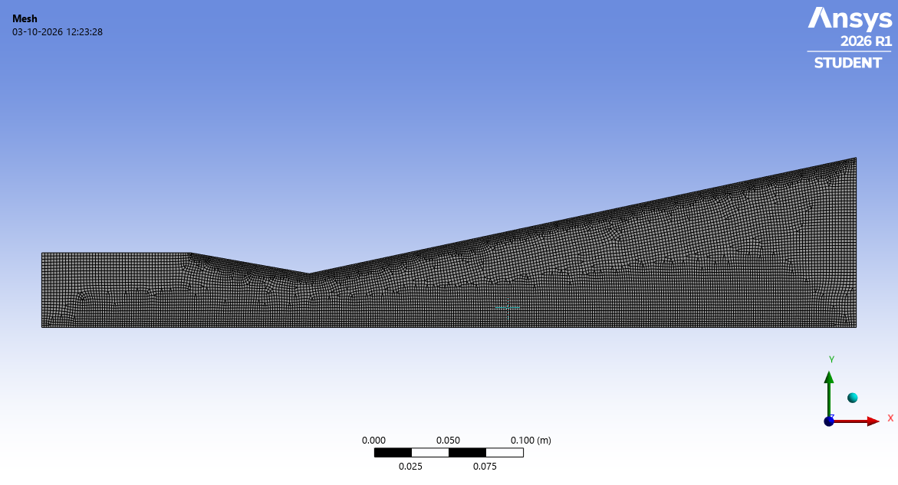
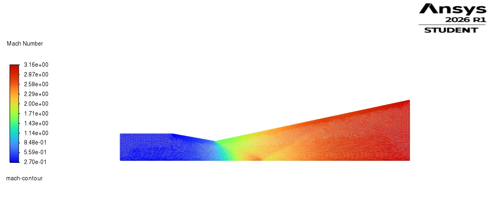
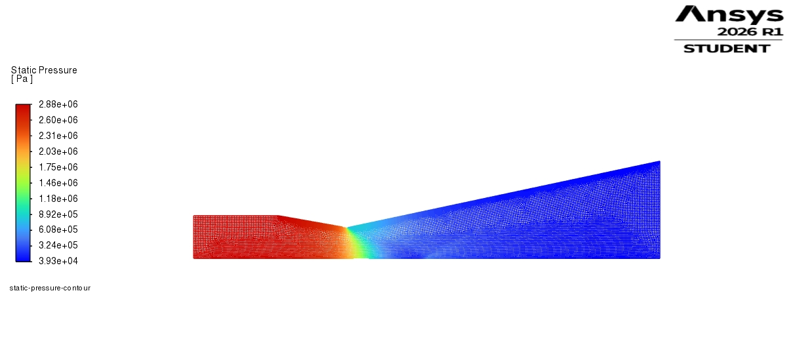
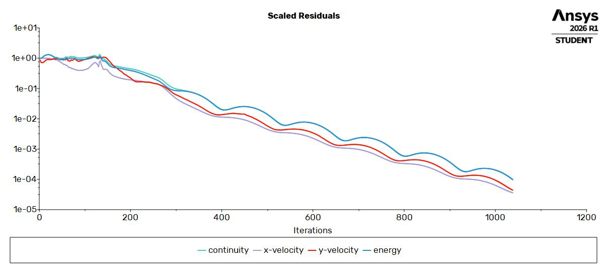

# Preliminary LOX/CH4 Rocket Engine Performance and Thermal Analysis

A preliminary engineering study of a 20 kN-class LOX/CH4 rocket engine, covering thermochemical performance, engine sizing, injector flow-area estimation, thermal screening, and 2-D axisymmetric compressible nozzle CFD.

## Objective

Develop a preliminary propulsion analysis workflow starting from LOX/CH4 thermochemical performance and progressing to first-order engine sizing and nozzle-flow verification.

## Analysis Performed

- NASA CEA oxidizer-to-fuel (O/F) sweep
- Selection of O/F = 3.0 for the preliminary design point
- 20 kN engine throat and exit sizing
- LOX/CH4 mass-flow calculation
- Preliminary injector flow-area sizing
- Regenerative cooling thermal screening
- 2-D axisymmetric compressible nozzle CFD
- Comparison of CFD results with CEA-based reference values

## Tools

- NASA CEA
- ANSYS Fluent
- Python
- ANSYS DesignModeler
- ANSYS Meshing

## Key Results

- Target thrust: 20 kN
- Chamber pressure: 30 bar
- O/F: 3.0
- Estimated total mass flow: ~6.60 kg/s
- Throat diameter: ~72 mm
- Exit diameter: ~228 mm
- CFD-predicted thrust: ~19.6 kN
- CFD exit Mach number: ~3.10

## Nozzle CFD

A 2-D axisymmetric compressible-flow simulation was performed in ANSYS Fluent to verify the preliminary nozzle sizing.

### Mesh

### Mach Number

### Static Pressure

### Residuals

## Scope

This is a preliminary screening-level analysis. The study does not include detailed combustion modelling, turbopump design, injector atomization, combustion stability analysis, or experimental validation.